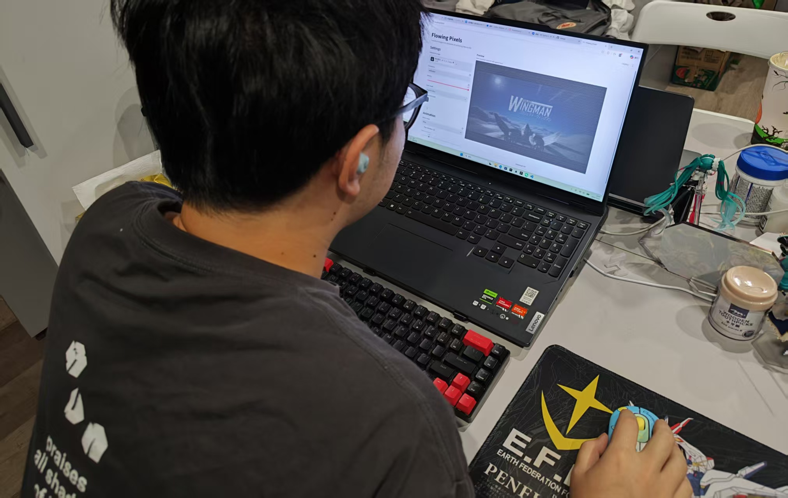

Process

1. Starting Idea

My initial idea was to create an interactive experience that allows users to transform an ordinary image into character-based visual art. I wanted the project to be more than a simple image filter. Users should be able to experiment with different visual settings and immediately see how their choices affect the result.

I initially focused on the core image-to-character transformation. As the project developed, I expanded the idea to include customizable characters, image density, color settings, and animations.

2. Design and Code Changes

Image Density and Aspect Ratio

During development, I noticed that changing the density should affect the level of detail rather than simply resize the entire image. I adjusted the grid-generation logic so that density controls the number of character cells used to represent the image. I also preserved the original image's aspect ratio to avoid unnecessary distortion.

Custom Characters and Color Modes

I added an input field that allows users to enter their own characters, words, phrases, or emoticons. This makes the output more personal and encourages experimentation.

I also implemented two color modes: monochrome and original colors. The monochrome mode allows users to customize both the character color and the background color, while the original-colors mode retains the image's color information.

Animation Design

I experimented with several animation concepts. Initially, I considered different motion effects, including wave, ripple, and flow. However, ripple and flow did not feel sufficiently different from the wave animation.

I therefore simplified the animation options to three styles:

Wave: Characters move continuously in a wave pattern.
Pixel Build: Characters gradually appear outward from the center.
Outline → Fill: High-contrast edges appear first, followed by the remaining characters.

I also made animation optional and disabled it by default, so users can view the finished result immediately. To improve performance, I limited the animation loop to approximately 30 frames per second and allowed it to stop when animation is not needed.

3. User Trial and Response

I invited my roommate to test Flowing Pixels at different stages of development. His feedback helped me identify several issues that I had overlooked when developing and testing the application on my own computer.

He found the initial page layout inconvenient. The controls and image preview were arranged in a way that required him to scroll down the page to see the generated image after adjusting the parameters. This interrupted the process of experimentation because he could not easily compare the effects of different settings. In response, I redesigned the layout into a two-column structure, placing the controls on the left and the image preview on the right.

He also pointed out that the Wave, Ripple, and Flow animations looked too similar. Although I had implemented several animation styles, the differences between them were not obvious enough. I reconsidered the purpose of each animation and removed Ripple and Flow. I replaced them with Pixel Build, which reveals characters outward from the center, and Outline → Fill, which reveals prominent image edges before filling in the remaining characters.

Besides, his computer had slightly lower hardware performance than mine and struggled more when running the application, particularly with high-density images and animations. So I kept animation disabled by default, limited the animation loop to approximately 30 FPS. These changes were intended to reduce unnecessary rendering work, although performance can still vary with image density and device capabilities.

4. Use of AI Tools

I used ChatGPT as a development assistant throughout the project. It helped me generate and revise Python code, troubleshoot issues, and improve the project.

AI Suggestion I Kept

ChatGPT suggested using Streamlit for the interface and Pillow for image processing. I adopted this approach because it allowed me to build an interactive image-processing application in Python without having to implement the entire interface from scratch.

AI Suggestion I Rejected

During the user trial, I explored ripple and flow effects suggested or developed during AI-assisted iteration. In practice, these effects were not visually distinct enough from the wave animation. Rather than keeping every proposed option, I removed ripple and flow and replaced them with the Outline → Fill concept.