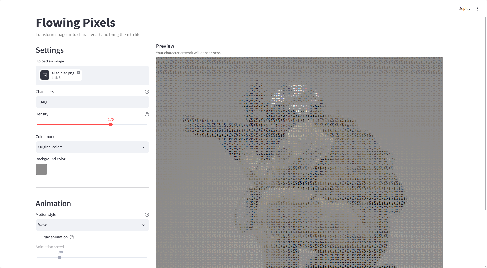

# Flowing Pixels

**Flowing Pixels** is an interactive experience that transforms images into animated character art built with Python and Streamlit. It transforms uploaded images into a grid of characters, creating a visual effect similar to pixel art or ASCII art. Users can customize the characters, adjust the image density, switch between color modes, and watch the image appear through different animation styles.

## 1. Project Idea

The idea behind Flowing Pixels is to explore how an ordinary image can be transformed into a different visual form through simple characters. Instead of displaying an image as a collection of pixels, the application represents its visual information using repeated text characters.

The project focuses on experimentation and immediate visual feedback. Users can adjust the visual parameters and see how each change affects the result. Animation adds another dimension to the experience by turning the image-generation process into part of the artwork.

## 2. Intended Users

Flowing Pixels is designed for:

 **Casual users** who enjoy customizing images and discovering different visual effects.

No programming knowledge is required to use the application.

## 3. Main Interactions

### Upload an Image
Users can upload an image in PNG, JPG, JPEG, or WEBP format. The application converts it into a grid of character-based visual elements while preserving the original image's aspect ratio.

### Customize the Characters
Users can enter their own characters, words, phrases, or emoticons. The selected content is repeated across the image, allowing users to create different textures and visual styles.

### Adjust Image Density
A density slider controls the number of character cells used to represent the image. Lower density produces a coarser result, while higher density captures more visual detail.

### Switch Color Modes
Users can choose between two color modes:

- **Monochrome:** Customize the character color and background color.
- **Original Colors:** Preserve the color information of the uploaded image.

### Explore Animation Styles
When animation is enabled, users can choose between three motion styles:

- **Wave:** Characters move in a continuous wave pattern.
- **Pixel Build:** Characters gradually appear outward from the center of the image.
- **Outline → Fill:** The application reveals high-contrast edge details first, then fills in the remaining characters to form the complete image.

### Export the Text Art
Users can download a TXT file containing the repeated character pattern for further experimentation or use in other text-based projects.

## 4. How to Run

### Requirements
- Python 3.10 or later
- uv for Python environment and dependency management

### Setup

1. Clone or download this repository.
2. Open the project folder in a terminal.
3. Install the required dependencies:

   uv sync

4. Start the application:

   uv run streamlit run app.py

5. Open the local URL displayed in the terminal, usually `http://localhost:8501`, in your browser.

Upload an image and start experimenting with the controls.

## 5. Technologies Used

- **Python** — application logic and image processing workflow.
- **Streamlit** — user interface and interactive controls.
- **Pillow (PIL)** — image loading and processing.
- **HTML Canvas and JavaScript** — character rendering and animation in the browser.
- **uv** — dependency and environment management.

## 6. Known Limitations

- **Image detail:** The result depends on the original image, character selection, and density setting. Small details may be lost, especially at lower densities.
- **Performance:** High-density images contain more character cells and require more rendering work. Animations may take longer to complete on slower devices.
- **Character appearance:** Different characters have different shapes and visual weights, so some character sets may represent brightness and image details less effectively than others.
- **Text export:** The TXT export provides a repeated character pattern rather than a complete reproduction of the image's rendered colors and brightness.

## 7. Project Goal

Flowing Pixels explores the relationship between images, text, and motion through a simple interactive tool. By combining customization with real-time visual feedback, it encourages users to experiment with how visual information can be represented in different ways.